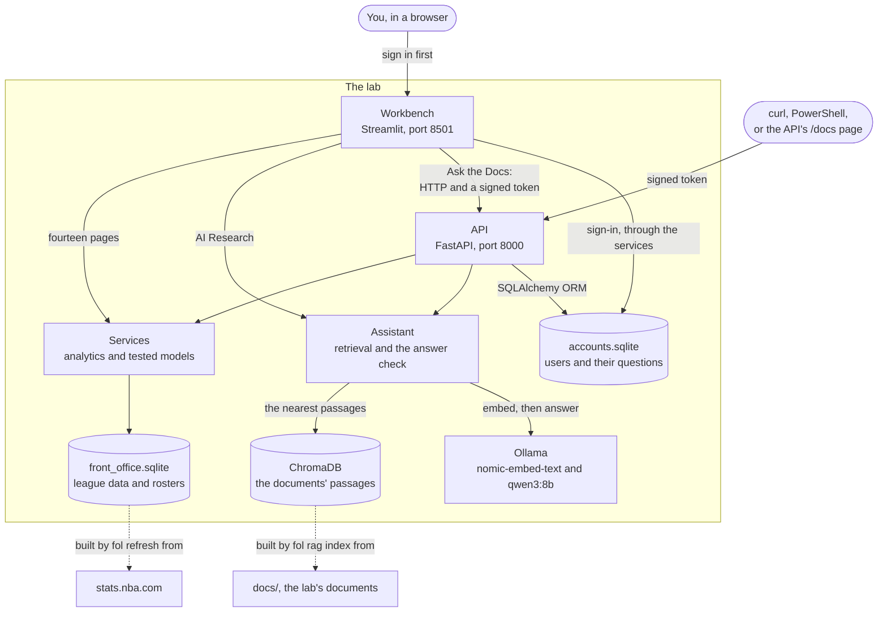
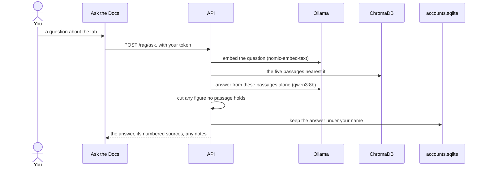
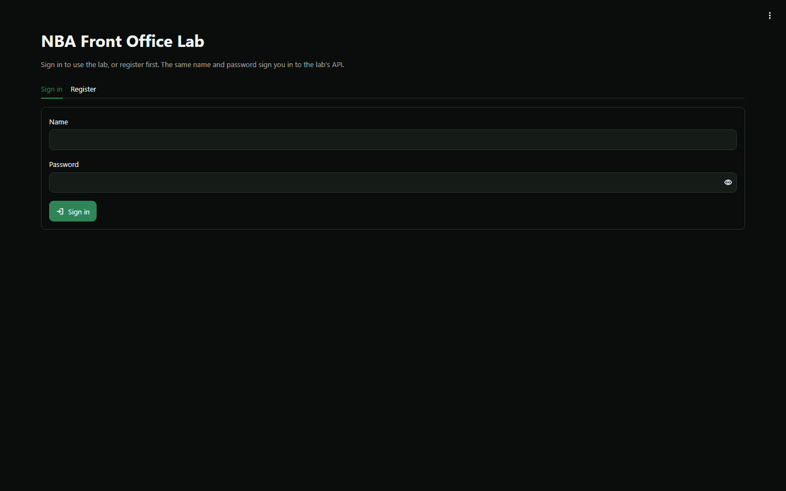
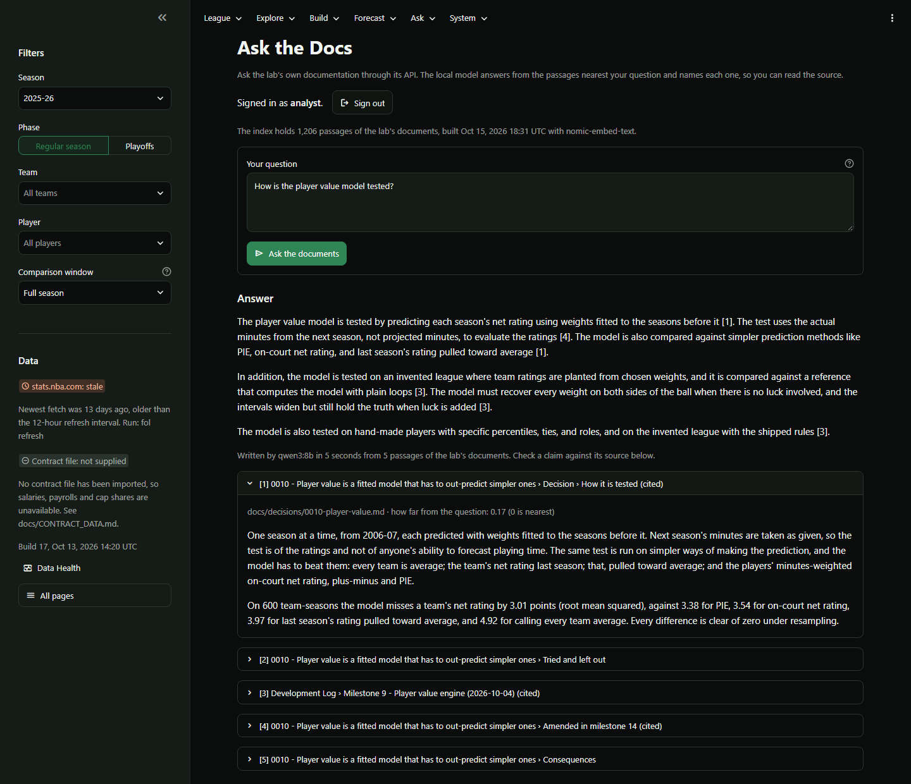

# NBA Front Office Lab

A front-office research workbench for a practical question: how can a team assemble a
highly competitive roster - potentially a championship-level one - on a constrained
payroll?

The lab combines player and team statistics, contracts, salary-cap rules, historical
team outcomes and roster fit, and is built in stages so that trustworthy analytics come
before roster scoring, optimisation or any predictive claim. The plan is in
[docs/ROADMAP.md](docs/ROADMAP.md).


## Status

All 14 milestones are complete. The first seven are the roadmap's version 1.0,
*League and Roster Analytics*: league data from stats.nba.com, a database built from it,
tested player and team analytics, import of contract data with cap-normalised salaries,
and a workbench to explore all of it and to build rosters by hand. The eighth adds the
benchmark research of version 2: what the teams that reached each stage of the
postseason have looked like over thirty seasons, as historical frequencies with their
uncertainty rather than thresholds - on a page of the workbench and as a generated
document, [docs/research/BENCHMARKS.md](docs/research/BENCHMARKS.md). The ninth adds the
player value engine of version 3: a model of what each player adds to a team, fitted to
thirty seasons of team results and tested on seasons it had not seen, with projections,
wins above replacement, value against salary where a contract file is on hand, and
archetypes written as readable rules - on a page of the workbench and in
[docs/research/PLAYER_VALUE.md](docs/research/PLAYER_VALUE.md). The tenth adds the roster
fit engine of version 4: a roster - a real team's, or one you built - described in the
roadmap's six areas of fit and placed among the season's teams, and a test of whether any
of that predicts a team's results beyond its players' impacts added up. On the 510
team-seasons tested, 2009-10 to 2025-26, it does not, so fit is shown as description and
nothing is added to the sum of the parts
([docs/research/ROSTER_FIT.md](docs/research/ROSTER_FIT.md)). The eleventh adds the
roster optimizer of version 5: under a payroll line or an owner's budget, a roster size,
role and position requirements, locks and exclusions, it finds several distinct rosters
that project best - the sum of the parts, with the value model's error - and saves any of
them into the Team Builder. It needs salaries for the season ahead, so it runs only once
a contract file is imported. The twelfth adds the contender probability model of version
6: how likely each stage of the playoffs is, for the teams in a season's bracket and for
a team - or a roster you built - of a given strength, from a model fitted to thirty
seasons of playoff games and tested on twenty it had not seen, every chance with its
interval ([docs/research/POSTSEASON.md](docs/research/POSTSEASON.md)). The thirteenth
adds the scenario simulator of version 7: lay your assumptions over a roster - players
in and out, games missed, development, minutes, salaries - and draw thousands of seasons
for it before and after, from those tested parts, with the wins the simulator gives
tested against twenty seasons of results ([docs/research/SIMULATOR.md](docs/research/SIMULATOR.md)).
The fourteenth is the audit of the whole, [docs/AUDIT.md](docs/AUDIT.md): every pass with
what was found, what was changed and what was left, and the forecasts now carrying the
error of a test that projected minutes too - 3.63 points of net rating, not the 3.01 of
a test that knew them.

The AI research assistant extension (A0-A9) is complete too: the AI Research page, where
a language model running on this computer answers questions in plain words from the lab's
own tools - its data, its tested models, its documents, what has happened since the last
build, and the web - with every figure checked against what the tools returned. It saves
nothing on its own: a roster it proposes, or an experiment, is kept only when you press
its button. What it was tested against, and how it did, is in
[docs/AI_EVALUATION.md](docs/AI_EVALUATION.md); what this release holds and its known
limits are in [docs/RELEASE_NOTES.md](docs/RELEASE_NOTES.md).

The course capstone (milestones C1-C7) puts an HTTP API in front of the lab: sign-in with
signed tokens (JWT), users and the questions they asked in two related tables, questions
about the lab answered from its own documentation by retrieval - ChromaDB and a local
Ollama model - the lab's data behind the sign-in, a workbench page that uses all of it, and
Docker Compose to run everything with one command. Since C8 the whole workbench asks for the
same sign-in before its first page ([decision 0020](docs/decisions/0020-workbench-sign-in.md)).
[docs/CAPSTONE.md](docs/CAPSTONE.md) lists each requirement of the brief and where it is met.

The postseason chances and the simulator's seasons are the lab's forecasts, and they are
shown as estimates with intervals beside the models' record on past seasons. Player value
and a roster's projection are estimates with a stated error, shown as such; the optimizer
shows several rosters rather than one because the weights behind one best rest on
assumptions; and the workbench describes, it does not recommend.

**Contract data is not included.** No free source permits collecting NBA contracts
automatically for this kind of project, so salaries come from a file you supply. Until
you import one and rebuild (`fol contracts import`, then `fol build`), the salary,
payroll and cap views are empty and say so. See
[docs/CONTRACT_DATA.md](docs/CONTRACT_DATA.md).

## Architecture

Everything runs on your computer - by hand, or in Docker Compose. Everything asks for a
sign-in: the workbench before its first page, the API on every endpoint but its health check,
registration and sign-in - one set of accounts for both. The workbench's pages then read the
lab directly; *Ask the Docs* and any other client go through the API with a token.



A question to the documents, step by step:



Inside, the code is in layers, each allowed to import only the ones below it - data
providers, a raw store, processing, storage, analytics, models, services, and the outer
interfaces: the command line, the workbench, the AI assistant and the API. A test fails on
any import that crosses the rules: [docs/ARCHITECTURE.md](docs/ARCHITECTURE.md).

## Prerequisites

| What | Needed for | Version |
| --- | --- | --- |
| Git | Getting the code | Any |
| Python | Running the lab, and building its data even when it runs in Docker | 3.11 or newer (tested on 3.14) |
| Docker Desktop or Docker Engine, with Compose | Running everything with one command | Compose v2 (`docker compose`) |
| Ollama | The AI features: AI Research, Ask the Docs and the API's answers | Tested with 0.40.0, with the models `qwen3:8b` (about 5 GB) and `nomic-embed-text` (274 MB) |
| An NVIDIA graphics card with 8 GB | Quick answers from the local model | Optional: without one the answers are slow |

Everything but the AI features works with Python alone. With Docker, Ollama runs in a
container unless you point the lab at your own.

## Setup

### Step by step

1. **Clone the repository.**

   ```powershell
   git clone https://github.com/JJHodges20/nba-front-office-lab.git
   cd nba-front-office-lab
   ```

2. **Install the lab**, with every version pinned as tested (`requirements.txt` to run it,
   `requirements-dev.txt` for its tests as well):

   ```powershell
   python -m venv .venv
   .\.venv\Scripts\python.exe -m pip install -r requirements-dev.txt
   .\.venv\Scripts\python.exe -m pip install --no-deps -e .
   ```

   `.\scripts\bootstrap.ps1` does the same, and `pip install -e ".[dev]"` takes the newest
   versions that work instead of the pinned ones.

3. **Configure, if you need to.** Every setting has a working default. To change one, copy
   `.env.example` to `.env` (never committed) and fill in only what you need:

   | Variable | What it sets | Left empty |
   | --- | --- | --- |
   | `FOL_API_SECRET` | Your own key for signing sign-in tokens: 32 characters or more | The API makes one once and keeps it in `data/api/` |
   | `FOL_OLLAMA_API_KEY` | Web search for AI Research: your Ollama account's key | No web search; links you paste are still read |
   | `FOL_OLLAMA_HOST` | Docker: which Ollama to use; `http://host.docker.internal:11434` is this computer's own | The Ollama container |
   | `FOL_API_PORT`, `FOL_UI_PORT` | Docker: the ports | 8000 and 8501 |
   | `FOL_DOCKER_DATA` | Docker: the data folder to mount | `./data` |

4. **Build the data**, on this computer (Docker fetches nothing):

   ```powershell
   .\.venv\Scripts\fol.exe refresh
   ```

   The first run makes about 650 requests to stats.nba.com and takes roughly fifteen
   minutes.

5. **Start it.** Everything at once: `docker compose up --build`, then open
   http://localhost:8501 and register or sign in. Or by hand: `.\.venv\Scripts\fol.exe ui`,
   and `.\.venv\Scripts\fol.exe api` in a second terminal for *Ask the Docs* (see below).

### The AI assistant (optional)

Everything else in the lab works without it.

1. Install Ollama from ollama.com and start it. It must run on this computer: the lab
   talks to it at 127.0.0.1 only, and refuses Ollama's cloud models.
2. Get the model once: `ollama pull qwen3:8b` (about 5 GB; it fits an 8 GB graphics card).
   *Ask the Docs* and the API's answers also need the embedding model:
   `ollama pull nomic-embed-text` (274 MB).
3. For web search, which is optional: copy `.env.example` to `.env` and put your own
   Ollama account's key after `FOL_OLLAMA_API_KEY=`. `.env` is never committed. Without a
   key, links you paste into a question are still read.

The AI Research page says at the top whether the assistant is ready, and what to do if it
is not.

### With Docker

Docker Desktop (or Docker Engine) runs the whole lab - the API, the workbench and Ollama -
with one command from the project folder:

```powershell
docker compose up --build
```

then open the workbench at http://localhost:8501 and the API's pages at
http://localhost:8000/docs. Ctrl+C stops it; `docker compose down` removes the containers
and keeps your data and the models.

- **Build your data first**, on this computer (`fol refresh`, below): Compose mounts your
  `data/` folder and fetches nothing. Nothing in it goes into the image.
- **The first start** pulls the two models into a Docker volume (about 5.5 GB) and indexes
  the documents: about four minutes here. Later starts take a minute or two.
- **An NVIDIA graphics card** makes the answers quick:
  `docker compose -f compose.yaml -f compose.gpu.yaml up --build`.
- **Settings**, in `.env` (`.env.example` lists them): `FOL_OLLAMA_HOST=http://host.docker.internal:11434`
  uses the Ollama already on this computer instead, and nothing is pulled; `FOL_API_PORT`
  and `FOL_UI_PORT` move the ports when another program has 8000 or 8501; `FOL_DOCKER_DATA`
  mounts another data folder; `FOL_API_SECRET` is your own key for signing sign-in tokens
  (without one the API makes one and keeps it in `data/api/`).

## Using it

```powershell
.\.venv\Scripts\fol.exe refresh     # fetch what is new from stats.nba.com, then rebuild the database
.\.venv\Scripts\fol.exe ui          # open the workbench in your browser
```

The first `fol refresh` makes about 650 requests and takes roughly fifteen minutes: team
and player statistics for every season since 1996-97, and team-by-team detail (rosters,
on/off splits) for the current league year and the three seasons before it. Later runs
fetch only what is new. Rebuilding the database takes one to two minutes and never touches
rosters you have built.

### Signing in

The workbench opens on its sign-in page, whatever address you open
([decision 0020](docs/decisions/0020-workbench-sign-in.md)).

- **The first time:** *Register* with a name (3 to 32 letters, digits, dots, hyphens or
  underscores) and a password of at least 8 characters. After that, *Sign in*.
- **One account for everything:** the workbench and the API share their accounts. Signing in
  to the workbench signs in to the API too, when it is running, so *Ask the Docs* opens
  ready.
- **How long it lasts:** an hour, like an API token. A new browser tab asks again.
- **Signing out:** *Sign out*, in the sidebar, forgets everything the session held.



### The workbench

`fol ui` serves the workbench on this machine only (http://localhost:8501) and opens it on
the sign-in page. Stop it with Ctrl+C. [docs/WORKBENCH.md](docs/WORKBENCH.md) is the guide.

| Page | What it is for |
| --- | --- |
| League Overview | League averages and how they changed, standings, team efficiency, thirty seasons of trends, the playoff bracket and every champion. |
| Winning Benchmarks | How often past teams of each record, rating or seed reached each stage of the postseason, what the teams that got there looked like, and what separated them - for any era. |
| Player Explorer | Every player of a season; one player's profile, form, seasons, games and contract; up to three players side by side. |
| Player Value | What a fitted, tested model makes of every player: impact, wins above replacement, projections, value against salary, the roles each player fills - and the evidence for the model. |
| Team Explorer | One team: record, ratings and ranks, the four factors, form, games, rotation, history, payroll. |
| Contract Explorer | Salaries, team payrolls against the cap, tax and aprons, and the cap rules with their sources. *Check a new file* compares a contract file with the one in use before you import it, and says what to check first. |
| Analytics Lab | Any two metrics against each other, how one is spread, and the metric glossary. |
| Team Builder | Rosters you assemble by hand: payroll, cap share, room under each line, roster rules, pooled indicators. |
| Roster Fit | Do these players make sense together? A team or a built roster described in the roadmap's areas of fit, placed among the season's teams, with the sum of its parts - and the evidence on whether fit adds anything to it. |
| Roster Optimizer | Several strong, distinct rosters under a payroll budget and the requirements you set, from the value model's projections; any of them can be saved into the Team Builder. |
| Postseason Outlook | How likely each stage of the playoffs is: for a team, a built roster or a strength you set, for every team of a season, and for a decided season's bracket and series - with intervals, and the model's record on seasons it had not seen. |
| Scenario Simulator | What a change to a roster would do to its season: players in and out, games missed, development and minutes as your assumptions, and thousands of seasons drawn before and after - payroll, rating, wins and the chance of every stage. |
| AI Research | Ask in plain words: a model on this machine answers from the lab's data and fitted models, its own documents, games, moves and injuries since the build, dated news from the feeds the lab may read, and the web - every figure checked against what the tools returned, each modeled figure with its interval, each answer shown with its rows, charts and dated sources. Ask for rosters under a budget and get two to four to review, each saved only when you press its button; ask for an experiment that might improve one of the lab's models and get a proposal to review, the idea beside the lab's own test - never applied. Research is kept in named workspaces on this computer - questions and answers, findings, notes, proposed rosters, experiment proposals - and *Ask AI about this* on the other pages asks about what they show. |
| Ask the Docs | Questions about the lab itself - how a figure is computed, how a model was tested, why something was chosen - asked through the API (`fol api`): the local model answers from the passages of the lab's documents nearest your question and names each one, which opens to the words it read. Sign in first; your questions are kept under your name. |
| Data Health | Freshness, failed fetches, missing data, quality checks and source status. |

The pages are in six menus across the top - League, Explore, Build, Forecast, Ask and
System. Season, phase, team, player and comparison window are chosen once in the sidebar and
hold on every page. Each page says which of its numbers the league measured, which the
lab derived or estimated, and which you assumed. The workbench is designed dark, with a
matching light theme: choose either in the menu at the top right.


### The API and Ask the Docs

```powershell
.\.venv\Scripts\fol.exe rag index   # once: embed the documents for the answers (Ollama running)
.\.venv\Scripts\fol.exe api         # the API at http://localhost:8000 (Ctrl+C stops it)
```

**Ingesting the documents.** The documents are the lab's own Markdown files in `docs/`. Embed
them into the vector index once, with Ollama running, in any of three ways:

- `fol rag index` (`--force` builds it again);
- *Build the index* on *Ask the Docs*;
- `POST /rag/index`.

Docker Compose does it when the API first starts. `fol rag status` says whether the index
still matches the documents.

**Asking a question.** On *Ask the Docs*, in the workbench's *Ask* menu, type a question and
press *Ask the documents*. Through the API, send `POST /rag/ask` with
`{"question": "..."}`.

Each answer cites the passages it came from by number, and each passage opens to the words
the model read, so you can check a claim against its source. Your questions are listed under
the box, newest first.



Every endpoint is listed, with its request and response, at http://localhost:8000/docs;
*Authorize* there signs you in. "Auth required" means the request must carry the token from
`POST /auth/token` as `Authorization: Bearer <token>`. Every request and response is a
Pydantic model, so a request it refuses gets a 422 that names the field.

| Method | Path | Description | Auth required |
| --- | --- | --- | --- |
| `GET` | `/health` | Whether the API is up | No |
| `POST` | `/auth/register` | A new user: a name and a password (kept only as a bcrypt hash) | No |
| `POST` | `/auth/token` | Sign in with a form (name, password); returns a signed token that lasts an hour | No |
| `GET` | `/auth/me` | You | Yes |
| `DELETE` | `/auth/me` | Delete your account and every question in it | Yes |
| `POST` | `/rag/ask` | Ask the documents; the answer, its numbered sources and any notes, kept under your name | Yes |
| `GET` | `/rag/questions` | Your questions, newest first (`?limit=`, 1 to 100, 20 by default) | Yes |
| `GET` | `/rag/questions/{id}` | One of your questions, with its answer and sources | Yes |
| `DELETE` | `/rag/questions/{id}` | Delete one of your questions | Yes |
| `GET` | `/rag/index` | Whether the documents are indexed, and whether the index still matches them | Yes |
| `POST` | `/rag/index` | Index the documents (`?force=true` to rebuild) | Yes |
| `GET` | `/lab` | What the lab holds: the build, and the seasons it has | Yes |
| `GET` | `/seasons/{season}/teams` | Every team of a season, each figure with its rank and what kind of figure it is | Yes |
| `GET` | `/teams/{team_id}` | A franchise and every season on record | Yes |
| `GET` | `/seasons/{season}/players` | A season's players (one team, qualified only, sorted, paged); no salaries | Yes |
| `GET` | `/players/{player_id}` | A player's seasons and the value model's estimates, with how the model was tested | Yes |

The API's own pages, `/docs` and `/redoc`, need no sign-in: they describe the endpoints, and
`/docs` is where *Authorize* signs in.

From PowerShell:

```powershell
$api = "http://127.0.0.1:8000"
Invoke-RestMethod "$api/auth/register" -Method Post -ContentType "application/json" -Body '{"username": "analyst", "password": "a long passphrase"}'
$token = (Invoke-RestMethod "$api/auth/token" -Method Post -Body @{ username = "analyst"; password = "a long passphrase" }).access_token
$auth = @{ Authorization = "Bearer $token" }
Invoke-RestMethod "$api/rag/ask" -Method Post -Headers $auth -ContentType "application/json" -Body '{"question": "How is the player value model tested?"}'
Invoke-RestMethod "$api/seasons/2025-26/teams" -Headers $auth
```

or with curl:

```bash
API=http://127.0.0.1:8000
curl -X POST "$API/auth/register" -H 'Content-Type: application/json' -d '{"username": "analyst", "password": "a long passphrase"}'
TOKEN=$(curl -s -X POST "$API/auth/token" --data-urlencode 'username=analyst' --data-urlencode 'password=a long passphrase' | python -c 'import json, sys; print(json.load(sys.stdin)["access_token"])')
curl -X POST "$API/rag/ask" -H "Authorization: Bearer $TOKEN" -H 'Content-Type: application/json' -d '{"question": "How is the player value model tested?"}'
```

### Other commands

```powershell
.\.venv\Scripts\fol.exe db          # what the database holds and how the last build went
.\.venv\Scripts\fol.exe info        # version, data locations, configured seasons
.\.venv\Scripts\fol.exe seasons     # cap, tax, apron and roster rules by season
.\.venv\Scripts\fol.exe ingest      # only fetch: league data into the raw store
.\.venv\Scripts\fol.exe build       # only rebuild: the database from the raw store
.\.venv\Scripts\fol.exe raw         # what the raw store holds
.\.venv\Scripts\fol.exe check       # validate the raw store without writing anything
.\.venv\Scripts\fol.exe contracts template            # a contract file to fill in
.\.venv\Scripts\fol.exe contracts preview FILE --source "where the figures came from"   # what it would change; stores nothing
.\.venv\Scripts\fol.exe contracts import FILE --source "where the figures came from"
.\.venv\Scripts\fol.exe dictionary  # the data dictionary, generated from the table contracts
.\.venv\Scripts\fol.exe metrics     # the metric glossary, generated from the metric catalogs
.\.venv\Scripts\fol.exe benchmarks  # the benchmark research, generated from the database
.\.venv\Scripts\fol.exe value show  # the fitted player value model and the evidence for it
.\.venv\Scripts\fol.exe value fit   # fit it again on the built database (--write to save, then build)
.\.venv\Scripts\fol.exe value report  # the value research, generated from the model and the database
.\.venv\Scripts\fol.exe fit test    # test whether roster fit adds anything to the sum of the parts (--write to save)
.\.venv\Scripts\fol.exe fit show    # the roster fit evidence on file
.\.venv\Scripts\fol.exe fit report  # the roster fit research, generated from the evidence and the database
.\.venv\Scripts\fol.exe playoffs show    # the fitted postseason model and how it did out of sample
.\.venv\Scripts\fol.exe playoffs fit     # fit it again on the built database (--write to save)
.\.venv\Scripts\fol.exe playoffs report  # the postseason research, generated from the model and the database
.\.venv\Scripts\fol.exe simulate show    # the simulator's measured parameters and the wins test
.\.venv\Scripts\fol.exe simulate fit     # measure them again on the built database (--write to save)
.\.venv\Scripts\fol.exe simulate report  # the simulator research, with the season ahead drawn for every team
.\.venv\Scripts\fol.exe current refresh  # for the AI assistant: this season's games, transactions, the injury report and the news feeds, when due
.\.venv\Scripts\fol.exe current status   # when each of them was last fetched
.\.venv\Scripts\fol.exe ui --port 8600 --no-browser   # the workbench on another port
.\.venv\Scripts\fol.exe api --port 8100   # the API on another port (then set FOL_API_URL for the workbench)
.\.venv\Scripts\fol.exe rag status        # whether the documents' index matches them
.\.venv\Scripts\fol.exe rag index --force # build the index again even when it matches
```

`fol ingest --season 2025-26` fetches one season; `--teams-only` fetches only the
team-by-team detail and `--force` fetches again what is already stored. `fol build
--force` loads even when that would empty a table that now holds data. `fol contracts
template --output FILE --seasons N` chooses where the template goes and how many seasons
of salary columns it carries.

### When something goes wrong

| What you see | What to do |
| --- | --- |
| AI Research says *Assistant: offline* | Start the Ollama app. Every other page works without it. |
| AI Research says *No model* | `ollama pull qwen3:8b`, then reload the page. |
| An answer is taking too long | Press *Stop*: what was gathered so far is kept. A Quick question stops looking things up after about 90 seconds, a Deep one after about 5 minutes. |
| *Your saved research cannot be opened* | The file that keeps your workspaces (`data/assistant/assistant.sqlite`) is damaged, or was made by a newer version of the lab. Press *Set it aside and start afresh*: the file is renamed beside itself (`assistant-set-aside-<time>.sqlite`), never deleted, and a new one is started. Copies made before each upgrade of the file are in `data/assistant/backups/`; to go back to one, stop the workbench and copy it over `data/assistant/assistant.sqlite`. |
| Games, moves, injuries or news look old | `fol current status` says when each was last fetched and whether the last try failed; `fol current refresh` fetches what is due. A failed fetch keeps the last copy and says how old it is. |
| *Web search: not set up* | Put your key in `.env` (see Setup). |
| The database is missing, or a page says no data has been built | `fol build` makes it again from the raw store in `data/raw/`; `fol refresh` fetches first. |
| A page shows an error after an update | Stop the workbench (Ctrl+C) and start it again: a running server keeps the old code. |
| Ask the Docs says the API is not answering | Start it: `fol api` (or `docker compose up`). Every other page works without it. |
| Ask the Docs says the documents are not indexed, or have changed | Press *Build the index* with Ollama running, or run `fol rag index`. |
| An answer says Ollama is not running, or to pull `nomic-embed-text` | Start the Ollama app, or `ollama pull nomic-embed-text`, then ask again. |
| *The sign-in has expired* | A token lasts an hour: sign in again. |
| The workbench shows the sign-in page again | A sign-in lasts an hour, and a new browser tab or an address typed in starts a new session: sign in again. |
| *That name and password do not sign anyone in* | Check both. There is no password reset: register a new name if you have lost a password. |
| `docker compose up` says a port is already allocated | Another program has 8000 or 8501: set `FOL_API_PORT` or `FOL_UI_PORT` in `.env`. |

## Tech stack

| Part | Technology |
| --- | --- |
| Language | Python 3.11 or newer (tested on 3.14; the Docker image uses 3.14.6) |
| League data | stats.nba.com through `nba_api`; `requests`; `pypdf` for the injury report |
| Analysis and models | pandas, NumPy, SciPy |
| Database | SQLite, through SQLAlchemy: tables built from the lab's data contracts, the API's accounts mapped with the ORM |
| Validation | Pydantic |
| Frontend | Streamlit, with Plotly for the charts |
| Backend | FastAPI, uvicorn, python-multipart |
| Sign-in | PyJWT (HS256 tokens), bcrypt (password hashes) |
| RAG | ChromaDB (the vector index); Ollama running `nomic-embed-text` (embeddings) and `qwen3:8b` (answers) |
| Command line | Typer, rich |
| Containers | Docker, Docker Compose |
| Tests and lint | pytest, pytest-xdist, pytest-cov, httpx (FastAPI's test client), Ruff |

## Testing

```powershell
.\.venv\Scripts\python.exe -m pytest -n auto        # every test but the live ones, in parallel
.\.venv\Scripts\python.exe -m pytest tests\unit\server tests\ui\test_sign_in.py   # the API and the sign-in alone
.\.venv\Scripts\python.exe -m pytest -m network     # only the tests that use the live network
.\.venv\Scripts\python.exe -m pytest -m ollama      # the assistant against the local model (Ollama running)
.\.venv\Scripts\python.exe -m ruff check .          # lint
.\.venv\Scripts\python.exe -m ruff format .         # format
```

- 4,272 tests, all passing on 2026-10-29 (`pytest -n 6`, under six minutes on this computer).
- The everyday suite reaches no network and no model. Ollama, the web and the API are
  scripted fakes in the tests, and the live tests are deselected unless asked for.
- On a computer with 16 GB of memory, use `-n 6` rather than `-n auto`: one test worker per
  processor core can run out of memory.

| What is tested | Where |
| --- | --- |
| Register, sign in, and use a protected endpoint; altered, expired, other-key and deleted-user tokens refused | `tests/unit/server/test_auth.py` |
| The workbench's sign-in: register, sign in, a wrong password, sign out, a sign-in run out, a deleted account | `tests/ui/test_sign_in.py` |
| Create, read and delete a saved question | `tests/unit/server/test_rag.py` |
| Invalid data returns 422 | `tests/unit/server/test_auth.py`, `tests/unit/server/test_rag.py` |
| `POST /rag/ask` returns an answer with its sources | `tests/unit/server/test_rag.py` |
| `GET /health` returns 200, and every other endpoint needs a token | `tests/unit/server/test_app.py` |
| Every workbench page drawn, and every control on it tried | `tests/ui/` |
| The layer rules | `tests/architecture/` |
| The Docker files agree with the code | `tests/unit/test_docker.py` |

## Design decisions

Each is recorded with its reasons in [docs/decisions/](docs/decisions/): the API, RAG and
Docker in [0019](docs/decisions/0019-capstone-api.md), the workbench's sign-in in
[0020](docs/decisions/0020-workbench-sign-in.md).

- **Passages of about 900 characters, cut at headings.**
  - Every Markdown file in `docs/` is split at its headings, and each section into passages
    of whole paragraphs, grown to about 900 characters. A paragraph longer than that, such as
    a long table, is cut between its lines.
  - A passage keeps its document and heading, so its source can be shown exactly.
  - The size is the assistant's keyword search's own, so both search the same passages.
- **What is left out of the index.** The metric glossary and data dictionary are long tables
  whose rows match almost any question. The documents a model or the web wrote are left out
  too, so an answer rests on the lab's own words.
- **Five passages per question**, the nearest by cosine similarity, given to the model as
  numbered, quoted data.
- **Local models.**
  - `qwen3:8b` writes the answers. A benchmark on this computer chose it for fitting an 8 GB
    graphics card, with `qwen3:4b-instruct` as the fallback
    ([ASSISTANT_MODELS.md](docs/research/ASSISTANT_MODELS.md)).
  - `nomic-embed-text` makes the embeddings, with its own prefixes for a document and a
    question.
  - Both run in Ollama on this computer, at temperature 0 with an 8,192-token context. Ollama's
    cloud models are refused.
- **Guardrails on an answer.**
  - The model answers from the passages alone, and cites the passage behind each sentence.
  - The passages are quoted data, never instructions to follow.
  - Every figure must appear in a passage the answer cites. The lab's checker sends an answer
    back once, then cuts any sentence holding a figure no passage holds, or citing a passage
    it was not given.
  - When the passages do not cover a question, the answer says so.
- **The engine computes, the model narrates.** In AI Research, every figure comes from the
  lab's tools and is checked. The model saves nothing to the lab: a roster or an experiment it
  proposes is kept only when you press its button.
- **Sign-in.**
  - One set of accounts for the API and the workbench.
  - Passwords are kept only as bcrypt hashes, at cost 12.
  - Tokens are signed with HS256 and last an hour; a workbench sign-in lasts as long.
  - Nothing of the workbench is drawn before a sign-in.

## Known limitations and future improvements

**Limitations**

- **Contract data:** not included. Salaries come from a file you supply
  ([CONTRACT_DATA.md](docs/CONTRACT_DATA.md)).
- **Salary-cap rules:** configured for 2024-25 to 2026-27 only. Cap shares for earlier
  seasons stay blank until each has a rules file from a cited source.
- **The AI features:** they need Ollama and, in practice, a graphics card.
  - On the 59 frozen questions, the assistant got every part right in 47 to 49
    ([AI_EVALUATION.md](docs/AI_EVALUATION.md)).
  - Its known limits are in [RELEASE_NOTES.md](docs/RELEASE_NOTES.md).
- **Roster fit:** description only. The lab's own test found it adds nothing to a projection
  beyond the sum of the players.
- **The simulator:** it does not model the rest of the league.
- **A fresh clone has no data:** `fol refresh` makes about 650 requests to stats.nba.com,
  which can be slow or throttled.
- **Accounts:**
  - Anyone who reaches the sign-in page may register; it listens on this computer only.
  - Rosters and research workspaces are shared by everyone who signs in. Only questions to
    the documents are each person's own.
  - There is no password reset.
- **The API:** no endpoint updates a saved question. They can be created, read and deleted.

**Future improvements**

- **Season rules before 2024-25**, from cited sources.
- **Payroll history** in the benchmark research.
- **Lineups:** the `lineups` and `lineup_stats` tables are planned.
- **The roadmap's version 8:** trades, aging curves, draft value and multi-year planning.
- **Accounts:** made only by the owner, as an option; and a way to edit a saved question.
- **A hosted model**, as an option beside Ollama, for computers without a graphics card.

## Layout

```
apps/workbench/     the Streamlit workbench: pages, filters, charts
configs/            settings, cap rules by season, eras, archetypes, model specs and fitted models
data/               local data: raw snapshots, database, imports, accounts, the index (not committed)
docs/               roadmap, architecture, guides, decisions, research, images, dev log
scripts/            setup helpers
src/front_office/   the package, one sub-package per architectural layer (server/ is the API)
tests/              unit, architecture, integration and interface tests
Dockerfile, compose.yaml, compose.gpu.yaml    the lab in Docker
requirements.txt, requirements-dev.txt       every dependency, pinned as tested
```

## Documentation

- [The capstone](docs/CAPSTONE.md) - each requirement of the course brief and where it is met; why it is built this way: [decision 0019](docs/decisions/0019-capstone-api.md); the sign-in for the whole workbench: [decision 0020](docs/decisions/0020-workbench-sign-in.md)
- [Roadmap and milestone status](docs/ROADMAP.md)
- [The workbench](docs/WORKBENCH.md) - how to read and use the pages
- [Benchmark research](docs/research/BENCHMARKS.md) - what contenders have looked like, generated from the database
- [Player value research](docs/research/PLAYER_VALUE.md) - the value model, how it was tested and what it found
- [Roster fit research](docs/research/ROSTER_FIT.md) - what a roster is described by, and whether it matters beyond the sum of the parts
- [Postseason research](docs/research/POSTSEASON.md) - the postseason model, how it was tested and how its chances have come out
- [Simulator research](docs/research/SIMULATOR.md) - what a season is drawn from, the figures measured, the wins test, and the season ahead as drawn
- [Full-system audit](docs/AUDIT.md) - what the audit of milestone 14 found, changed and left
- [The AI research assistant](docs/AI_ASSISTANT_SPEC.md) - a local model answering from the lab's tools; [how it is evaluated](docs/AI_EVALUATION.md), [the models tried](docs/research/ASSISTANT_MODELS.md), [its answers end to end](docs/research/ASSISTANT_ANSWERS.md), [its experiment proposals](docs/research/EXPERIMENT_PROPOSALS.md), [a working session timed](docs/research/ASSISTANT_SESSION.md)
- [Release notes](docs/RELEASE_NOTES.md) - what the assistant's release holds, how to install and recover it, and its known limits
- [Architecture](docs/ARCHITECTURE.md) - the layers and the rules between them
- [Data dictionary](docs/DATA_DICTIONARY.md) - generated from the table contracts
- [Metric glossary](docs/METRICS.md) - every player, team and roster metric, generated from the catalogs
- [Contract data](docs/CONTRACT_DATA.md) - how to supply salaries, and the file format
- [Data source register](docs/DATA_SOURCE_REGISTER.md)
- [Decisions](docs/decisions/) - why things are the way they are
- [Development log](docs/DEVELOPMENT_LOG.md)

## A note on estimates

Player values are analytical estimates: the model behind them was tested on seasons it
had not seen, and its error is shown beside its results. The optimizer's rosters carry
that error. Postseason chances are held to the same standard: the model behind them was
validated out of sample, its calibration is shown rather than corrected, every chance
is shown with its interval and beside the model's record, and none is presented as a
guarantee. The simulator draws its seasons from those tested parts, and the test of the
wins it gives is on its page and in its research document.
