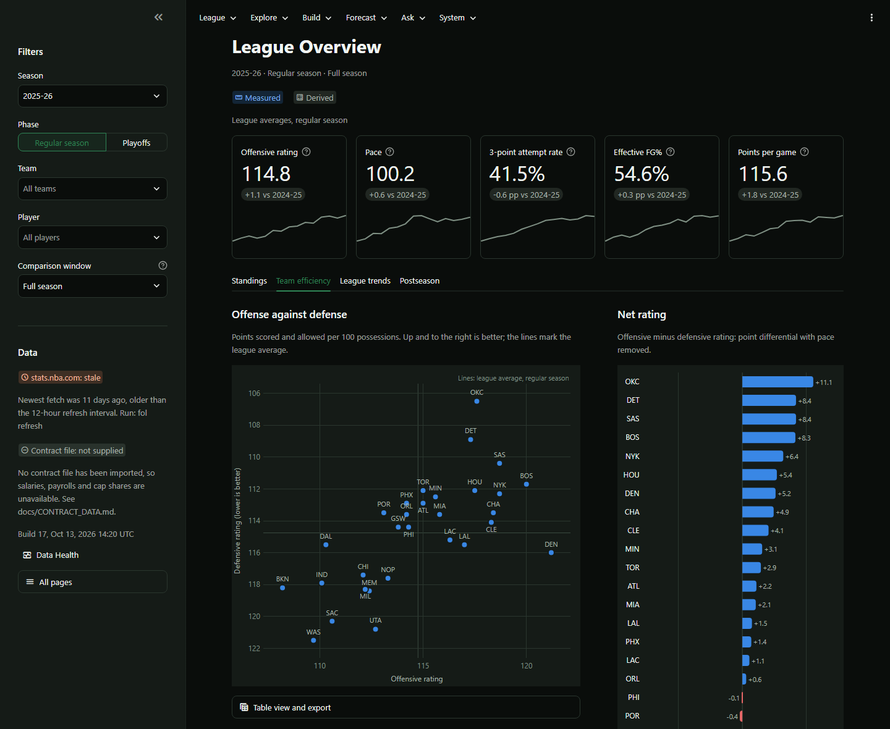
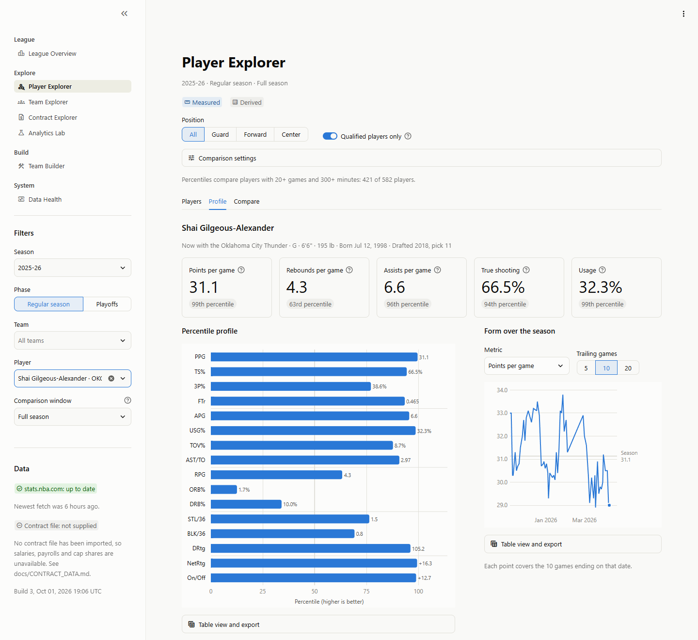
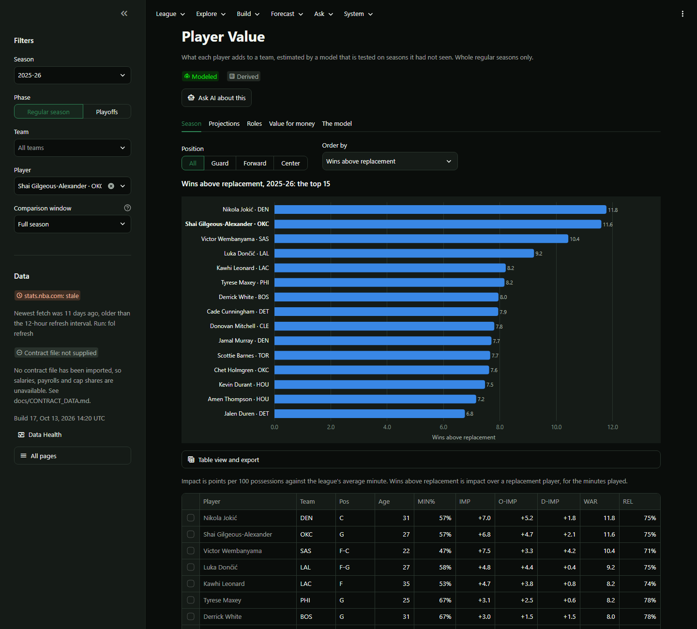
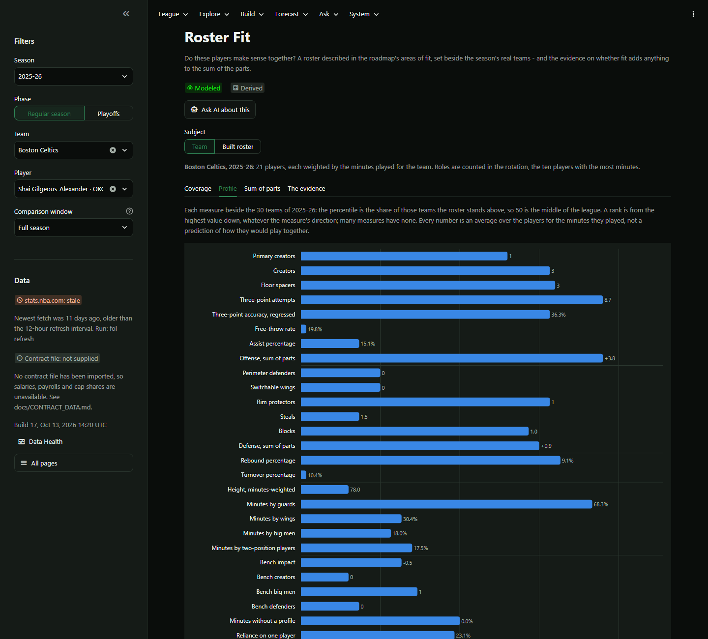
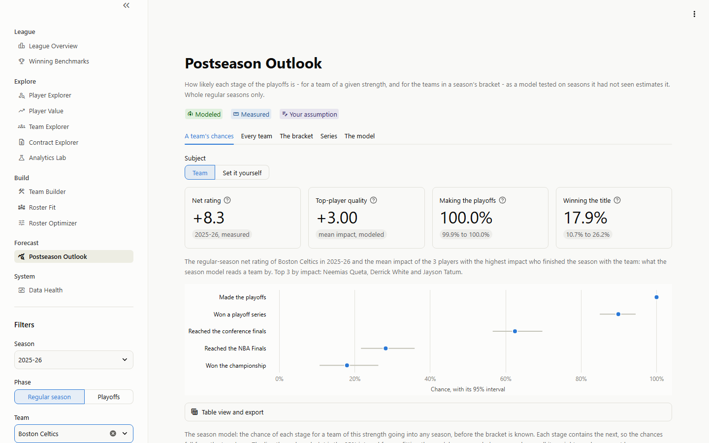
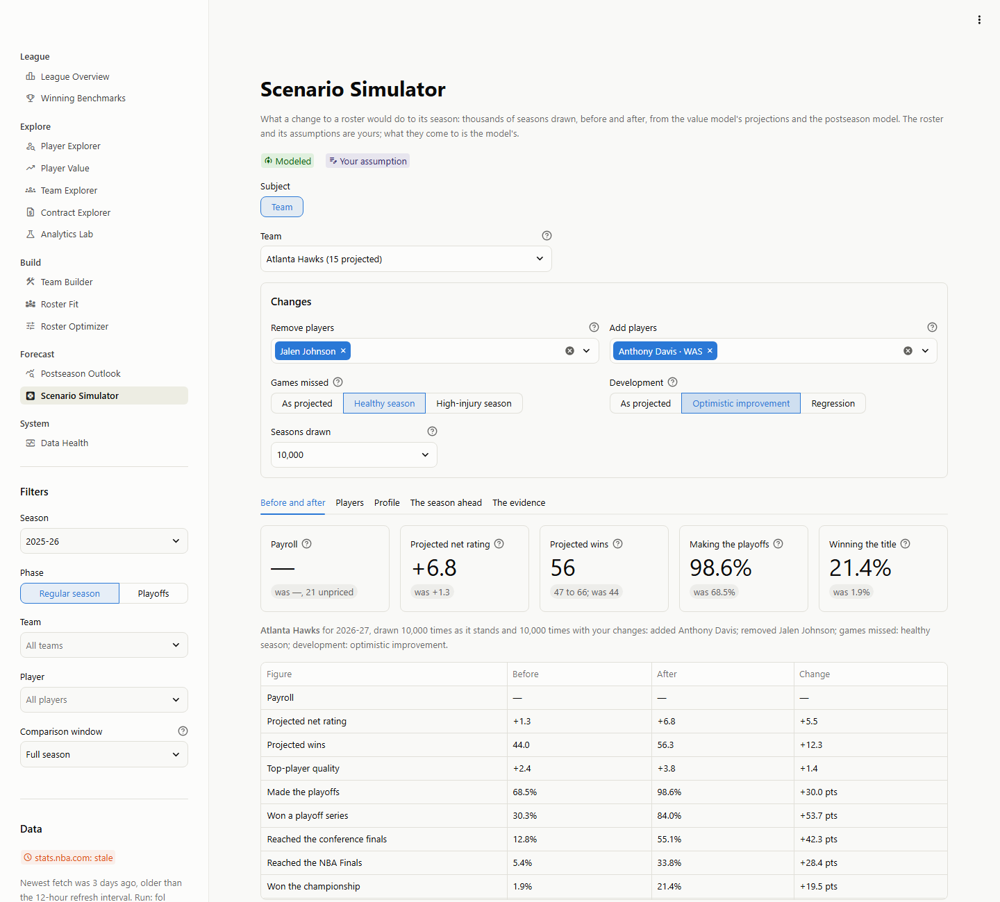
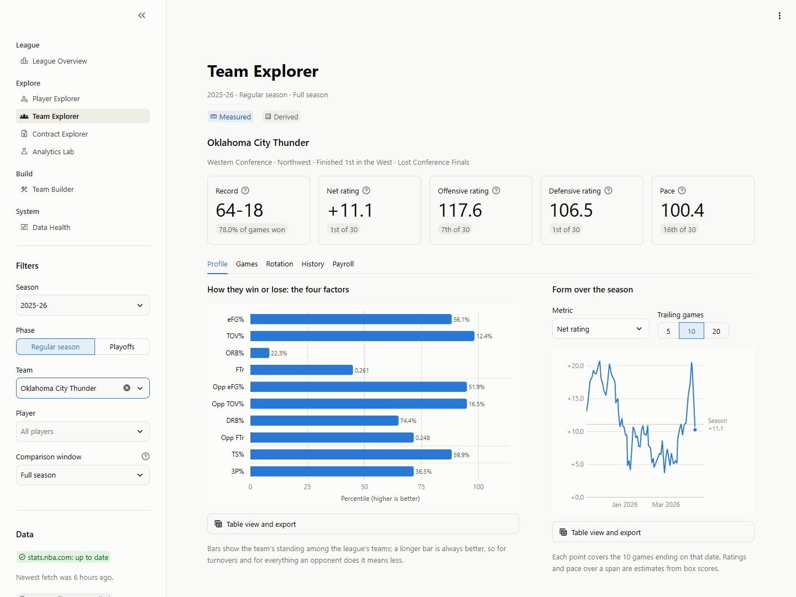
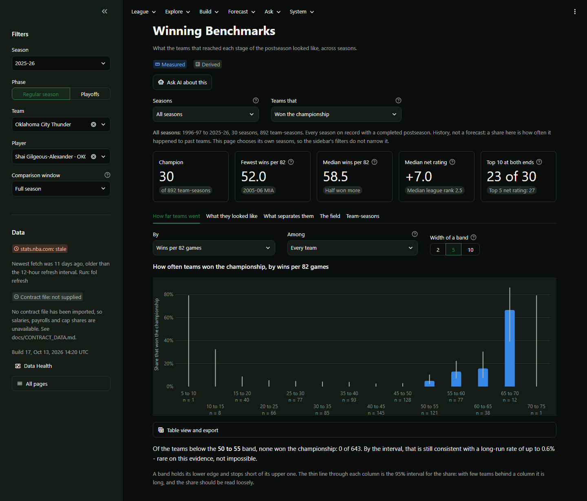
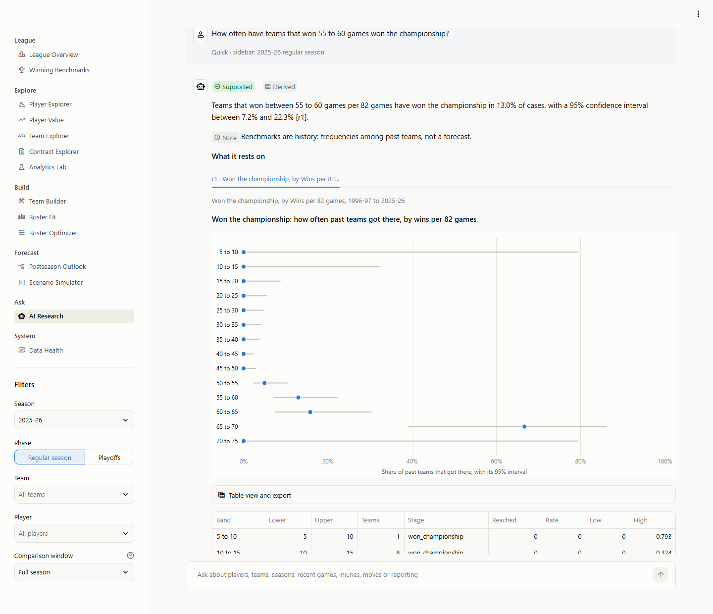

# NBA Front Office Lab

A front-office research workbench for a practical question: how can a team assemble a
highly competitive roster - potentially a championship-level one - on a constrained
payroll?

The lab combines player and team statistics, contracts, salary-cap rules, historical
team outcomes and roster fit, and is built in stages so that trustworthy analytics come
before roster scoring, optimisation or any predictive claim. The plan is in
[docs/ROADMAP.md](docs/ROADMAP.md).



## Status

All 14 milestones are complete. The first seven are the roadmap's version 1.0,
*League and Roster Analytics*: league data from stats.nba.com, a database built from it,
tested player and team analytics, import of contract data with cap-normalised salaries,
and a workbench to explore all of it and to build rosters by hand. The eighth adds the
benchmark research of version 2: what the teams that reached each stage of the
postseason have looked like over thirty seasons, as historical frequencies with their
uncertainty rather than thresholds - on a page of the workbench and as a generated
document, [docs/research/BENCHMARKS.md](docs/research/BENCHMARKS.md). The ninth adds the
player value engine of version 3: a model of what each player adds to a team, fitted to
thirty seasons of team results and tested on seasons it had not seen, with projections,
wins above replacement, value against salary where a contract file is on hand, and
archetypes written as readable rules - on a page of the workbench and in
[docs/research/PLAYER_VALUE.md](docs/research/PLAYER_VALUE.md). The tenth adds the roster
fit engine of version 4: a roster - a real team's, or one you built - described in the
roadmap's six areas of fit and placed among the season's teams, and a test of whether any
of that predicts a team's results beyond its players' impacts added up. On the 510
team-seasons tested, 2009-10 to 2025-26, it does not, so fit is shown as description and
nothing is added to the sum of the parts
([docs/research/ROSTER_FIT.md](docs/research/ROSTER_FIT.md)). The eleventh adds the
roster optimizer of version 5: under a payroll line or an owner's budget, a roster size,
role and position requirements, locks and exclusions, it finds several distinct rosters
that project best - the sum of the parts, with the value model's error - and saves any of
them into the Team Builder. It needs salaries for the season ahead, so it runs only once
a contract file is imported. The twelfth adds the contender probability model of version
6: how likely each stage of the playoffs is, for the teams in a season's bracket and for
a team - or a roster you built - of a given strength, from a model fitted to thirty
seasons of playoff games and tested on twenty it had not seen, every chance with its
interval ([docs/research/POSTSEASON.md](docs/research/POSTSEASON.md)). The thirteenth
adds the scenario simulator of version 7: lay your assumptions over a roster - players
in and out, games missed, development, minutes, salaries - and draw thousands of seasons
for it before and after, from those tested parts, with the wins the simulator gives
tested against twenty seasons of results ([docs/research/SIMULATOR.md](docs/research/SIMULATOR.md)).
The fourteenth is the audit of the whole, [docs/AUDIT.md](docs/AUDIT.md): every pass with
what was found, what was changed and what was left, and the forecasts now carrying the
error of a test that projected minutes too - 3.63 points of net rating, not the 3.01 of
a test that knew them.

The postseason chances and the simulator's seasons are the lab's forecasts, and they are
shown as estimates with intervals beside the models' record on past seasons. Player value
and a roster's projection are estimates with a stated error, shown as such; the optimizer
shows several rosters rather than one because the weights behind one best rest on
assumptions; and the workbench describes, it does not recommend.

**Contract data is not included.** No free source permits collecting NBA contracts
automatically for this kind of project, so salaries come from a file you supply. Until
you import one and rebuild (`fol contracts import`, then `fol build`), the salary,
payroll and cap views are empty and say so. See
[docs/CONTRACT_DATA.md](docs/CONTRACT_DATA.md).

## Setup

Requires Python 3.11 or newer.

```powershell
.\scripts\bootstrap.ps1
```

or by hand:

```powershell
python -m venv .venv
.\.venv\Scripts\python.exe -m pip install -e ".[dev]"
```

## Using it

```powershell
.\.venv\Scripts\fol.exe refresh     # fetch what is new from stats.nba.com, then rebuild the database
.\.venv\Scripts\fol.exe ui          # open the workbench in your browser
```

The first `fol refresh` makes about 650 requests and takes roughly fifteen minutes: team
and player statistics for every season since 1996-97, and team-by-team detail (rosters,
on/off splits) for the current league year and the three seasons before it. Later runs
fetch only what is new. Rebuilding the database takes one to two minutes and never touches
rosters you have built.

### The workbench

`fol ui` serves the workbench on this machine only (http://localhost:8501) and opens it.
Stop it with Ctrl+C. [docs/WORKBENCH.md](docs/WORKBENCH.md) is the guide.

| Page | What it is for |
| --- | --- |
| League Overview | League averages and how they changed, standings, team efficiency, thirty seasons of trends, the playoff bracket and every champion. |
| Winning Benchmarks | How often past teams of each record, rating or seed reached each stage of the postseason, what the teams that got there looked like, and what separated them - for any era. |
| Player Explorer | Every player of a season; one player's profile, form, seasons, games and contract; up to three players side by side. |
| Player Value | What a fitted, tested model makes of every player: impact, wins above replacement, projections, value against salary, the roles each player fills - and the evidence for the model. |
| Team Explorer | One team: record, ratings and ranks, the four factors, form, games, rotation, history, payroll. |
| Contract Explorer | Salaries, team payrolls against the cap, tax and aprons, and the cap rules with their sources. *Check a new file* compares a contract file with the one in use before you import it, and says what to check first. |
| Analytics Lab | Any two metrics against each other, how one is spread, and the metric glossary. |
| Team Builder | Rosters you assemble by hand: payroll, cap share, room under each line, roster rules, pooled indicators. |
| Roster Fit | Do these players make sense together? A team or a built roster described in the roadmap's areas of fit, placed among the season's teams, with the sum of its parts - and the evidence on whether fit adds anything to it. |
| Roster Optimizer | Several strong, distinct rosters under a payroll budget and the requirements you set, from the value model's projections; any of them can be saved into the Team Builder. |
| Postseason Outlook | How likely each stage of the playoffs is: for a team, a built roster or a strength you set, for every team of a season, and for a decided season's bracket and series - with intervals, and the model's record on seasons it had not seen. |
| Scenario Simulator | What a change to a roster would do to its season: players in and out, games missed, development and minutes as your assumptions, and thousands of seasons drawn before and after - payroll, rating, wins and the chance of every stage. |
| AI Research | Ask in plain words: a model on this machine answers from the lab's data and fitted models, its own documents, games, moves and injuries since the build, dated news from the feeds the lab may read, and the web - every figure checked against what the tools returned, each modeled figure with its interval, each answer shown with its rows, charts and dated sources. Ask for rosters under a budget and get two to four to review, each saved only when you press its button. Research is kept in named workspaces on this computer - questions and answers, findings, notes, proposed rosters - and *Ask AI about this* on the other pages asks about what they show. |
| Data Health | Freshness, failed fetches, missing data, quality checks and source status. |

Season, phase, team, player and comparison window are chosen once in the sidebar and
hold on every page. Each page says which of its numbers the league measured, which the
lab derived or estimated, and which you assumed.

















### Other commands

```powershell
.\.venv\Scripts\fol.exe db          # what the database holds and how the last build went
.\.venv\Scripts\fol.exe info        # version, data locations, configured seasons
.\.venv\Scripts\fol.exe seasons     # cap, tax, apron and roster rules by season
.\.venv\Scripts\fol.exe ingest      # only fetch: league data into the raw store
.\.venv\Scripts\fol.exe build       # only rebuild: the database from the raw store
.\.venv\Scripts\fol.exe raw         # what the raw store holds
.\.venv\Scripts\fol.exe check       # validate the raw store without writing anything
.\.venv\Scripts\fol.exe contracts template            # a contract file to fill in
.\.venv\Scripts\fol.exe contracts preview FILE --source "where the figures came from"   # what it would change; stores nothing
.\.venv\Scripts\fol.exe contracts import FILE --source "where the figures came from"
.\.venv\Scripts\fol.exe dictionary  # the data dictionary, generated from the table contracts
.\.venv\Scripts\fol.exe metrics     # the metric glossary, generated from the metric catalogs
.\.venv\Scripts\fol.exe benchmarks  # the benchmark research, generated from the database
.\.venv\Scripts\fol.exe value show  # the fitted player value model and the evidence for it
.\.venv\Scripts\fol.exe value fit   # fit it again on the built database (--write to save, then build)
.\.venv\Scripts\fol.exe value report  # the value research, generated from the model and the database
.\.venv\Scripts\fol.exe fit test    # test whether roster fit adds anything to the sum of the parts (--write to save)
.\.venv\Scripts\fol.exe fit show    # the roster fit evidence on file
.\.venv\Scripts\fol.exe fit report  # the roster fit research, generated from the evidence and the database
.\.venv\Scripts\fol.exe playoffs show    # the fitted postseason model and how it did out of sample
.\.venv\Scripts\fol.exe playoffs fit     # fit it again on the built database (--write to save)
.\.venv\Scripts\fol.exe playoffs report  # the postseason research, generated from the model and the database
.\.venv\Scripts\fol.exe simulate show    # the simulator's measured parameters and the wins test
.\.venv\Scripts\fol.exe simulate fit     # measure them again on the built database (--write to save)
.\.venv\Scripts\fol.exe simulate report  # the simulator research, with the season ahead drawn for every team
.\.venv\Scripts\fol.exe current refresh  # for the AI assistant: this season's games, transactions, the injury report and the news feeds, when due
.\.venv\Scripts\fol.exe current status   # when each of them was last fetched
.\.venv\Scripts\fol.exe ui --port 8600 --no-browser   # the workbench on another port
```

`fol ingest --season 2025-26` fetches one season; `--teams-only` fetches only the
team-by-team detail and `--force` fetches again what is already stored. `fol build
--force` loads even when that would empty a table that now holds data. `fol contracts
template --output FILE --seasons N` chooses where the template goes and how many seasons
of salary columns it carries.

## Development

```powershell
.\.venv\Scripts\python.exe -m pytest -n auto  # tests, in parallel (live-network tests are deselected)
.\.venv\Scripts\python.exe -m ruff check .    # lint
.\.venv\Scripts\python.exe -m ruff format .   # format
```

## Layout

```
apps/workbench/     the Streamlit workbench: pages, filters, charts
configs/            settings, cap rules by season, eras, archetypes, model specs and fitted models
data/               local data: raw snapshots, database, imports (not committed)
docs/               roadmap, architecture, guides, decisions, research, images, dev log
scripts/            setup helpers
src/front_office/   the package, one sub-package per architectural layer
tests/              unit, architecture, integration and interface tests
```

## Documentation

- [Roadmap and milestone status](docs/ROADMAP.md)
- [The workbench](docs/WORKBENCH.md) - how to read and use the pages
- [Benchmark research](docs/research/BENCHMARKS.md) - what contenders have looked like, generated from the database
- [Player value research](docs/research/PLAYER_VALUE.md) - the value model, how it was tested and what it found
- [Roster fit research](docs/research/ROSTER_FIT.md) - what a roster is described by, and whether it matters beyond the sum of the parts
- [Postseason research](docs/research/POSTSEASON.md) - the postseason model, how it was tested and how its chances have come out
- [Simulator research](docs/research/SIMULATOR.md) - what a season is drawn from, the figures measured, the wins test, and the season ahead as drawn
- [Full-system audit](docs/AUDIT.md) - what the audit of milestone 14 found, changed and left
- [The AI research assistant](docs/AI_ASSISTANT_SPEC.md) - a local model answering from the lab's tools, in progress; [how it is evaluated](docs/AI_EVALUATION.md), [the models tried](docs/research/ASSISTANT_MODELS.md), [its answers end to end](docs/research/ASSISTANT_ANSWERS.md)
- [Architecture](docs/ARCHITECTURE.md) - the layers and the rules between them
- [Data dictionary](docs/DATA_DICTIONARY.md) - generated from the table contracts
- [Metric glossary](docs/METRICS.md) - every player, team and roster metric, generated from the catalogs
- [Contract data](docs/CONTRACT_DATA.md) - how to supply salaries, and the file format
- [Data source register](docs/DATA_SOURCE_REGISTER.md)
- [Decisions](docs/decisions/) - why things are the way they are
- [Development log](docs/DEVELOPMENT_LOG.md)

## A note on estimates

Player values are analytical estimates: the model behind them was tested on seasons it
had not seen, and its error is shown beside its results. The optimizer's rosters carry
that error. Postseason chances are held to the same standard: the model behind them was
validated out of sample, its calibration is shown rather than corrected, every chance
is shown with its interval and beside the model's record, and none is presented as a
guarantee. The simulator draws its seasons from those tested parts, and the test of the
wins it gives is on its page and in its research document.
